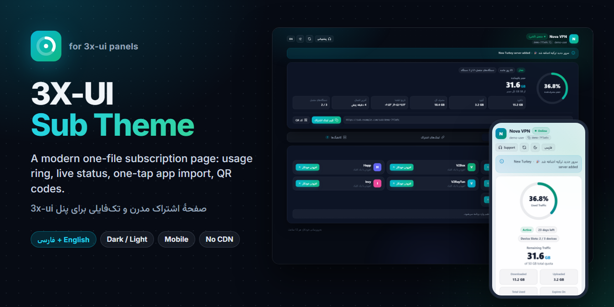
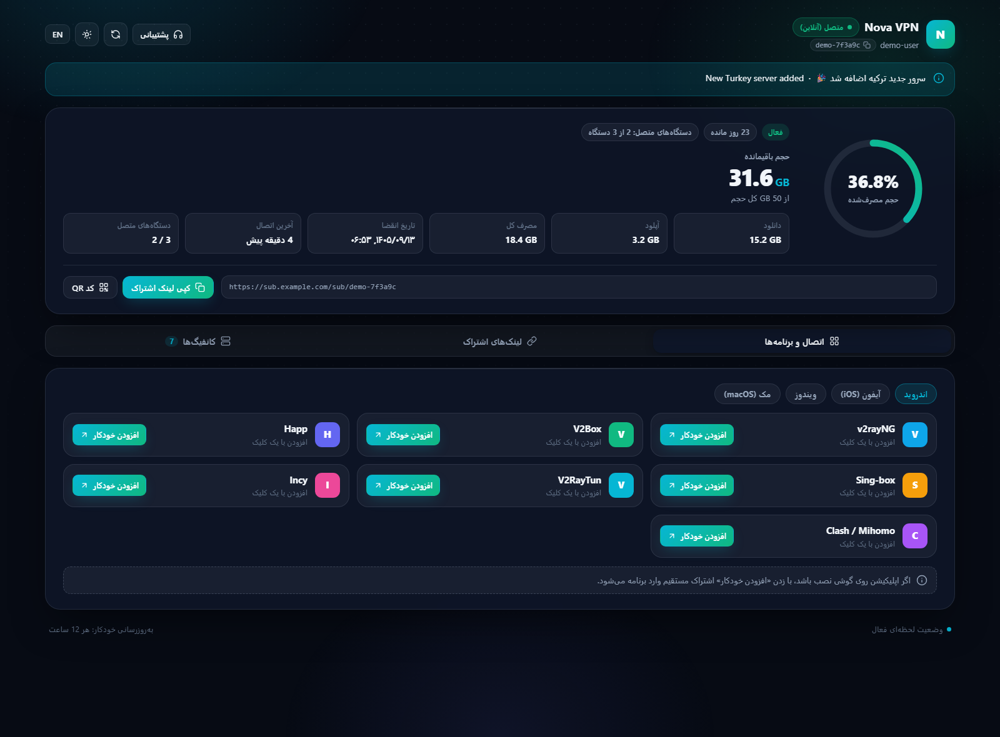
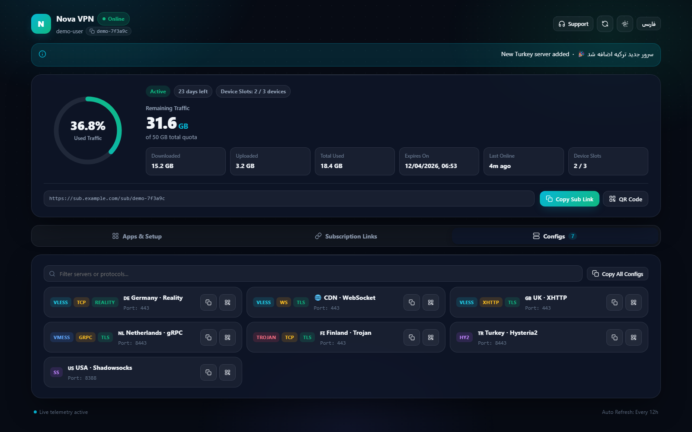
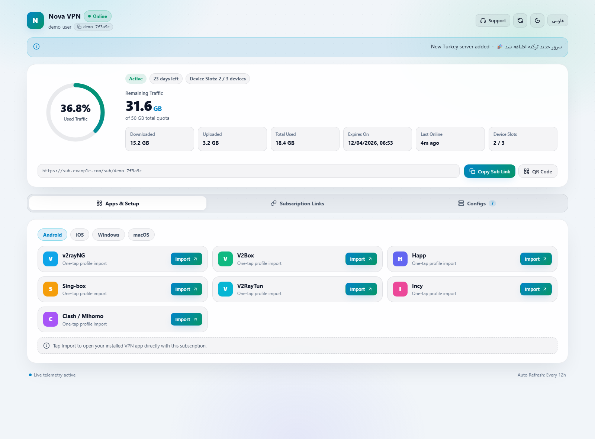
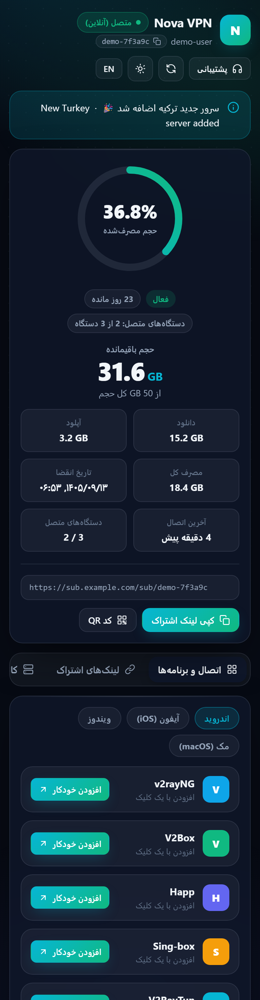
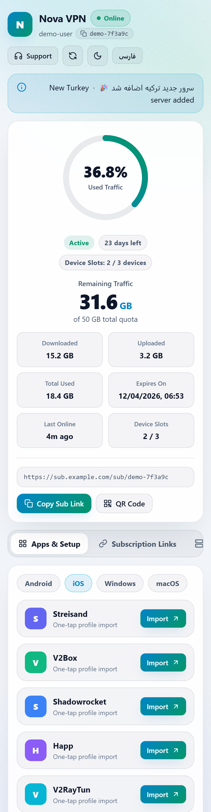

<div align="center">

# 3X-UI Sub Theme

[English](README.md) · **فارسی**

<a href="https://hits.sh/github.com/Plus98ir/3X-UI-Sub-Theme/"></a> <a href="https://corenetbase.com/#support"></a>

<div dir="rtl">

صفحه‌ی اشتراک مدرن و تک‌فایلی برای پنل‌های 3x-ui: حلقه‌ی مصرف، وضعیت زنده، افزودن با یک لمس به برنامه‌های VPN و کد QR. فارسی و انگلیسی، تیره و روشن، مناسب موبایل.

</div>



**[دموی زنده](https://corenetbase.com/3X-UI-Sub-Theme/demo/?lang=fa)** · **[وبسایت](https://corenetbase.com/3X-UI-Sub-Theme/)**

</div>

<details>
<summary><b>☕ Support · حمایت</b> — USDT (TRC20) / TRX</summary>
<br>
<p align="center"></p>

```
TA53aFyGNfSAcrCaJi9QmA9x5W47nPJcf7
```

> [!WARNING]
> **TRON network only.** Sending from ERC20 / BEP20 will lose the funds.<br>
> **فقط شبکه‌ی TRON.** ارسال از ERC20 یا BEP20 پول را از بین می‌برد.

</details>

<div dir="rtl">

> [!NOTE]
> این قالب غیررسمی است و جزو پروژه‌ی 3x-ui نیست. از تنظیم داخلی خود 3x-ui برای صفحه‌ی اشتراک سفارشی استفاده می‌کند، پس به خود پنل دست نمی‌زند.

## ویژگی‌ها

- **مصرف در یک نگاه:** حلقه با درصد مصرف، حجم باقیمانده، دانلود / آپلود / مصرف کل، تاریخ انقضا، روزهای مانده و آخرین اتصال.
- **وضعیت زنده:** نشان آنلاین و اعداد تا وقتی صفحه باز است هر ۱۵ ثانیه تازه می‌شوند (از `?format=info` و `/hwid-status` خود پنل)، به‌همراه دکمه‌ی به‌روزرسانی.
- **افزودن با یک لمس** برای برنامه‌های اندروید، iOS، ویندوز و مک: v2rayNG، V2Box، Happ، Sing-box، V2RayTun، Incy، Streisand، Shadowrocket، Clash / Mihomo و v2rayN (کپی). سیستم‌عامل بازدیدکننده خودکار انتخاب می‌شود.
- **لینک‌های اشتراک:** لینک اصلی، Xray JSON و Clash با دکمه‌ی کپی، دانلود و QR.
- **تب کانفیگ‌ها:** همه‌ی کانفیگ‌ها با برچسب پروتکل / ترنسپورت / امنیت، جستجو، کپی و QR؛ کپی همه با یک کلیک.
- **تعداد دستگاه‌ها** وقتی محدودیت HWID روشن است.
- **فارسی و انگلیسی** (طبق زبان مرورگر؛ تاریخ شمسی در فارسی یا وقتی تقویم پنل شمسی است)، **تیره و روشن**؛ انتخاب هر بازدیدکننده ذخیره می‌شود.
- **یک فایل HTML، بدون درخواست بیرونی:** بدون CDN و فونت آنلاین، QR داخل خود صفحه ساخته می‌شود. روی شبکه‌هایی که CDN فیلتر است هم کار می‌کند.
- از تنظیمات خود پنل استفاده می‌کند: عنوان اشتراک، لینک پشتیبانی، اطلاعیه و بازه‌ی به‌روزرسانی.

</div>

| دسکتاپ (تیره، فارسی) | کانفیگ‌ها (تیره، انگلیسی) |
|---|---|
|  |  |
| **دسکتاپ (روشن، انگلیسی)** | **موبایل** |
|  |   |

<div dir="rtl">

## نصب

به **3x-ui نسخه‌ی 3.10.0 یا جدیدتر** با سرویس اشتراک روشن نیاز دارد.

**۱. فایل `sub.html` را روی سرور بگذارید:**

</div>

```bash
mkdir -p /etc/x-ui/sub-theme
curl -fsSL -o /etc/x-ui/sub-theme/sub.html https://github.com/Plus98ir/3X-UI-Sub-Theme/releases/latest/download/sub.html
```

<div dir="rtl">

اگر GitHub روی سرورتان باز نمی‌شود، [`sub.html`](https://github.com/Plus98ir/3X-UI-Sub-Theme/releases/latest/download/sub.html) را روی کامپیوتر دانلود کنید و آپلود کنید:

</div>

```bash
scp sub.html root@YOUR_SERVER:/etc/x-ui/sub-theme/sub.html
```

<div dir="rtl">

**۲. در پنل:** **تنظیمات ← اشتراک ← پوشه قالب صفحه اشتراک** (Sub Theme Directory) را `/etc/x-ui/sub-theme/` بگذارید ← **ذخیره**.

**۳.** لینک اشتراک یک کاربر را در مرورگر باز کنید. برنامه‌های VPN همان اشتراک معمولی را می‌گیرند؛ فقط مرورگر این صفحه را می‌بیند.

**داکر:** پوشه باید داخل کانتینر باشد. با volume معمول `./db/:/etc/x-ui/`، فایل را روی سرور در `./db/sub-theme/sub.html` بگذارید و در پنل `/etc/x-ui/sub-theme/` را وارد کنید.

**به‌روزرسانی:** همان دستور `curl` را دوباره اجرا کنید. پنل تغییر فایل را خودش می‌فهمد و ری‌استارت لازم نیست.

**حذف:** «پوشه قالب صفحه اشتراک» را خالی کنید و ذخیره کنید؛ صفحه‌ی پیش‌فرض پنل برمی‌گردد.

## شخصی‌سازی

همه‌چیز داخل `sub.html` است:

- **رنگ‌ها:** `--accent` و `--accent-2` در `:root` (تیره) و `[data-theme="light"]`.
- **متن‌ها:** شیء `I18N` (بخش `fa` و `en`).
- **لیست برنامه‌ها:** تابع `buildApps()`، برای هر سیستم‌عامل.
- لوگو حرف اول تنظیم **عنوان اشتراک** پنل است.

این صفحه یک قالب Go (`html/template`) است: پنل `window.__SUB_DATA__ = {{ . }}` را با داده‌ی کاربر (حجم، انقضا، لینک‌ها، آدرس‌های اشتراک، عنوان، اطلاعیه…) پر می‌کند. اگر قالب خطا بدهد، پنل صفحه‌ی پیش‌فرض خودش را نشان می‌دهد.

## ساخت دمو و اسکرین‌شات‌ها

</div>

```powershell
python tools/make_demo.py                 # docs/demo/index.html با داده‌ی ساختگی
python -m http.server 8765 --bind 127.0.0.1 --directory docs   # در یک پنجره‌ی دیگر
.\tools\shoot.ps1                         # screenshots/ (Chrome بدون پنجره)
```

<div dir="rtl">

## مجوز

MIT

</div>
