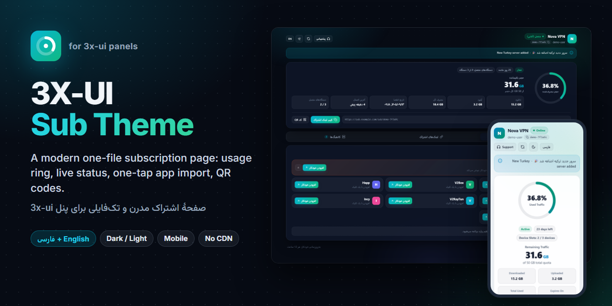
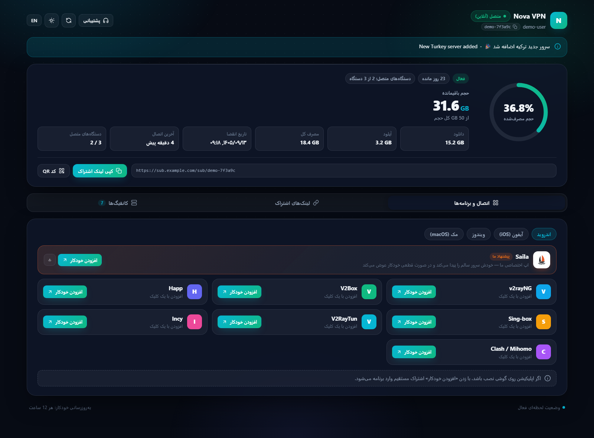
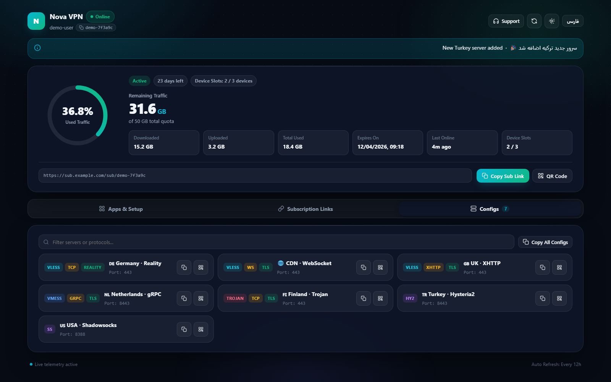
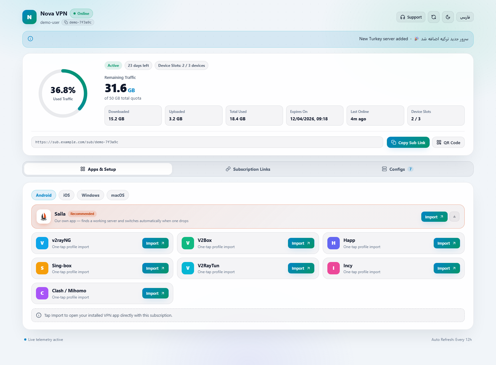
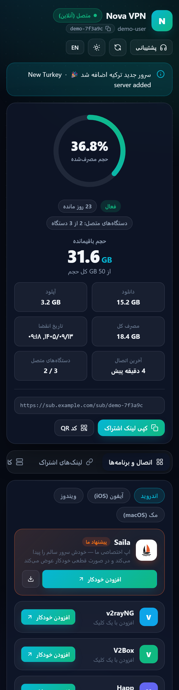
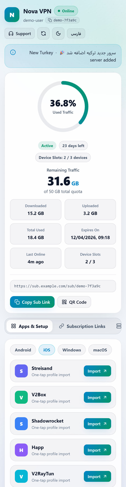

<div align="center">

# 3X-UI Sub Theme

**English** · [فارسی](README.fa.md)

<a href="https://hits.sh/github.com/Plus98ir/3X-UI-Sub-Theme/"></a> <a href="https://corenetbase.com/#support"></a>

A modern, one-file subscription page for 3x-ui panels: usage ring, live status, one-tap import into VPN apps, QR codes. Persian + English, dark + light, mobile-ready.



**[Download ZIP](https://corenetbase.com/3X-UI-Sub-Theme/download/3X-UI-Sub-Theme.zip)** · **[Live demo](https://corenetbase.com/3X-UI-Sub-Theme/demo/)** · **[Website](https://corenetbase.com/3X-UI-Sub-Theme/)**

</div>

<details>
<summary><b>☕ Support · حمایت</b> — USDT (TRC20) / TRX</summary>
<br>
<p align="center"></p>

```
TA53aFyGNfSAcrCaJi9QmA9x5W47nPJcf7
```

> [!WARNING]
> **TRON network only.** Sending from ERC20 / BEP20 will lose the funds.<br>
> **فقط شبکه‌ی TRON.** ارسال از ERC20 یا BEP20 پول را از بین می‌برد.

</details>

> [!NOTE]
> Unofficial template, not part of the 3x-ui project. It uses 3x-ui's built-in custom subscription page setting, so the panel itself is not modified.

## Features

- **Usage at a glance:** ring with the used percentage, remaining traffic, download / upload / total, expiry date, days left, last online.
- **Live status:** an online badge and the numbers refresh every 15 seconds while the page is open (from the panel's own `?format=info` and `/hwid-status` endpoints), plus a manual refresh button.
- **One-tap import** for Android, iOS, Windows and macOS apps: [Saila](https://corenetbase.com/Saila/) (featured, with a download button), v2rayNG, V2Box, Happ, Sing-box, V2RayTun, Incy, Streisand, Shadowrocket, Clash / Mihomo, v2rayN (copy). The visitor's platform is picked automatically.
- **Subscription links:** main, Xray JSON and Clash links with copy, download and QR buttons.
- **Configs tab:** every config with protocol / transport / security tags, search, copy and QR. Copy all in one click.
- **Device slots** when HWID limits are on.
- **Persian + English** (follows the browser; Jalali dates in Persian or when the panel's calendar is Jalali), **dark + light**, remembered per visitor.
- **One HTML file, no external requests:** no CDN, no web fonts to download, QR codes generated in the page. Works on networks where CDNs are filtered.
- Uses the panel's own settings: subscription title, support URL, announcement, update interval.

| Desktop (dark, Persian) | Configs (dark, English) |
|---|---|
|  |  |
| **Desktop (light, English)** | **Mobile** |
|  |   |

## Install

Needs **3x-ui v3.10.0 or newer** with the subscription service turned on.

**1. Put `sub.html` on the server:**

```bash
mkdir -p /etc/x-ui/sub-theme
curl -fsSL -o /etc/x-ui/sub-theme/sub.html https://raw.githubusercontent.com/Plus98ir/3X-UI-Sub-Theme/main/sub.html
```

If GitHub is blocked on your server, download [`sub.html`](https://corenetbase.com/3X-UI-Sub-Theme/download/sub.html) (or the [ZIP](https://corenetbase.com/3X-UI-Sub-Theme/download/3X-UI-Sub-Theme.zip)) on your PC and upload it:

```bash
scp sub.html root@YOUR_SERVER:/etc/x-ui/sub-theme/sub.html
```

**2. In the panel:** **Settings → Subscription → Sub Theme Directory** = `/etc/x-ui/sub-theme/` → **Save**.

**3.** Open any client's subscription link in a browser. VPN apps still get the normal subscription; only browsers see the page.

**Docker:** the folder must be inside the container. With the usual `./db/:/etc/x-ui/` volume, put the file in `./db/sub-theme/sub.html` on the host and use `/etc/x-ui/sub-theme/` in the panel.

**Update:** run the `curl` command again. The panel notices the changed file by itself, no restart needed.

**Remove:** clear **Sub Theme Directory** and save. The panel's default page comes back.

## Customize

Everything is in `sub.html`:

- **Colors:** `--accent` and `--accent-2` in `:root` (dark) and `[data-theme="light"]`.
- **Texts:** the `I18N` object (`fa` and `en`).
- **App list:** `buildApps()`, per platform.
- The logo is the first letter of the panel's **Subscription Title** setting.

The page is a Go `html/template`: the panel fills `window.__SUB_DATA__ = {{ . }}` with the client's data (traffic, expiry, links, sub URLs, title, announcement…). If the template fails, the panel falls back to its default page.

## Build the demo and screenshots

```powershell
python tools/make_demo.py                 # docs/demo/index.html with fake data
python tools/make_zip.py                  # docs/download/: ZIP + sub.html for the site
python -m http.server 8765 --bind 127.0.0.1 --directory docs   # in another window
.\tools\shoot.ps1                         # screenshots/ (headless Chrome)
```

## License

MIT
